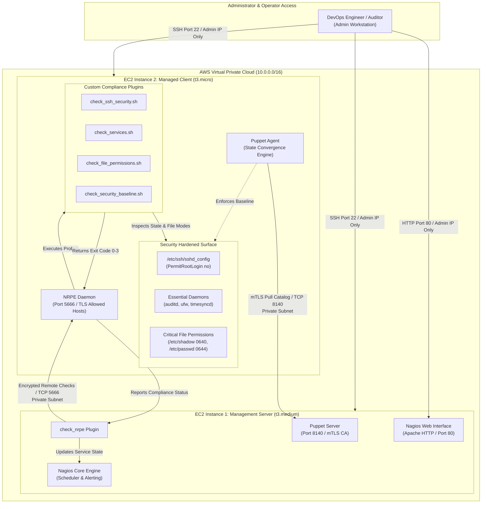
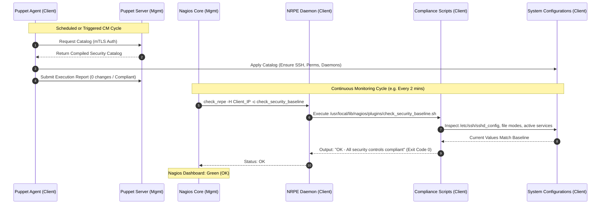
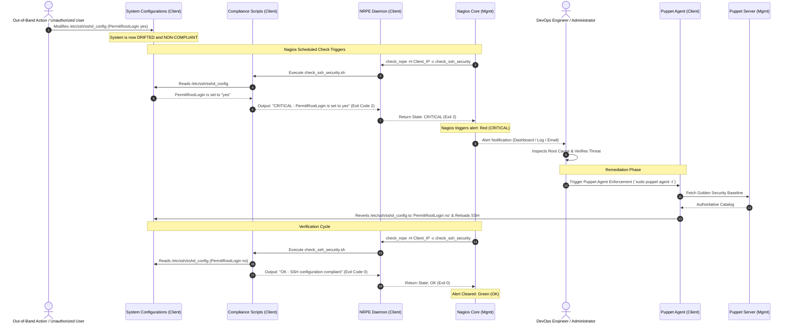

# System Architecture & Technical Specifications

**Project:** Automated Security Compliance and Configuration Drift Detection Using Puppet and Nagios on AWS EC2  
**Target Environment:** Amazon Web Services (AWS) VPC / Ubuntu Linux LTS  

---

## 1. High-Level Architectural Overview

The architecture employs a decoupled, multi-node management design consisting of two primary EC2 instances operating within an isolated AWS Virtual Private Cloud (VPC) subnet. The design separates **centralized governance and observability** (Instance 1) from the **workload execution surface** (Instance 2).

---

## 2. Infrastructure & Node Specifications

### 2.1 EC2 Instance 1: Management Server
- **Role:** Centralized authority for configuration management and infrastructure monitoring.
- **Recommended Instance Type:** `t3.medium` (2 vCPU, 4 GiB RAM) to accommodate the JVM footprint of Puppet Server along with Nagios Core and Apache.
- **Operating System:** Ubuntu Server 22.04 / 24.04 LTS.
- **Software Components:**
  - `puppetserver`: Serves as the Puppet Certificate Authority (CA) and compiles catalogs for managed nodes.
  - `nagios`: Core daemon managing monitoring schedules, check dispatch, state retention, and notification pipelines.
  - `nagios-plugins` & `check_nrpe`: Client binary used by Nagios to query remote NRPE daemons.
  - `apache2`: Web server hosting the Nagios Core web console.

### 2.2 EC2 Instance 2: Managed Client
- **Role:** Monitored Linux host undergoing configuration enforcement and security baseline compliance checks.
- **Recommended Instance Type:** `t3.micro` (1 vCPU, 1 GiB RAM) or `t3.small` (for low-cost lab environments).
- **Operating System:** Ubuntu Server 22.04 / 24.04 LTS.
- **Software Components:**
  - `puppet-agent`: Periodically contacts Puppet Server, pulls the compiled catalog, and enforces local system state.
  - `nagios-nrpe-server`: Remote plugin executor daemon listening on TCP port 5666, restricted strictly to accept queries from the Management Server's private IP.
  - Custom POSIX compliance plugins stored in `/usr/local/lib/nagios/plugins/` (or `/usr/lib/nagios/plugins/`).

---

## 3. Network Architecture and Security Groups

To maintain security best practices and prevent unauthorized exposure, **no management or monitoring ports are exposed to the public internet**.

### 3.1 Port Allocation Matrix

| Port | Protocol | Source | Destination | Purpose |
| :--- | :--- | :--- | :--- | :--- |
| **22** | TCP | Admin Workstation Public IP (`YOUR_IP/32`) | Management & Client Public IPs | Secure administrative SSH access. |
| **80 / 443** | TCP | Admin Workstation Public IP (`YOUR_IP/32`) | Management Server Public IP | Nagios Core web monitoring dashboard. |
| **8140** | TCP | Managed Client Private IP (`10.0.1.X/32`) | Management Server Private IP | Puppet Server catalog requests and mTLS certificate exchange. |
| **5666** | TCP | Management Server Private IP (`10.0.1.Y/32`) | Managed Client Private IP | Nagios NRPE remote probe execution. |
| **ICMP** | Echo | Management Server Private IP | Managed Client Private IP | Internal host ping / host alive monitoring. |

### 3.2 Security Group Rules

#### Security Group A: `sg-management` (Attached to Management Server)
- **Inbound:**
  - `TCP 22` from `YOUR_IP/32` (Admin SSH).
  - `TCP 80` from `YOUR_IP/32` (Nagios Web Dashboard).
  - `TCP 8140` from `sg-client` (Puppet Agent catalog queries).
- **Outbound:**
  - `TCP 5666` to `sg-client` (NRPE queries).
  - `TCP 80/443` to `0.0.0.0/0` (OS package repositories and security updates).

#### Security Group B: `sg-client` (Attached to Managed Client)
- **Inbound:**
  - `TCP 22` from `YOUR_IP/32` (Admin SSH).
  - `TCP 5666` from `sg-management` (NRPE check queries).
  - `ICMP Echo Request` from `sg-management` (Host alive check).
- **Outbound:**
  - `TCP 8140` to `sg-management` (Puppet Server communication).
  - `TCP 80/443` to `0.0.0.0/0` (OS package repositories).

---

## 4. Communication Workflows

### 4.1 Normal Convergence and Baseline Verification Workflow

---

### 4.2 Configuration Drift Detection and Remediation Sequence

When an unauthorized change occurs (e.g., an ad-hoc modification enables root SSH login or changes sensitive file permissions):

---

## 5. Defense-in-Depth & Architectural Principles

1. **Decoupled Verification:** Configuration management tools possess confirmation bias—they assume that if no manifest was compiled for a setting, it is not drifted. Independent Nagios Bash probes evaluate the live Linux OS kernel and filesystem directly without reading Puppet state files.
2. **Deterministic Exit Codes:** Every compliance probe complies strictly with the Nagios Plugin API standard:
   - `0`: OK (Compliant with security baseline).
   - `1`: WARNING (Non-critical deviation, e.g. service latency or deprecated parameter).
   - `2`: CRITICAL (High-risk security breach, e.g. root login permitted, shadow file world-readable).
   - `3`: UNKNOWN (Missing configuration file, syntax failure, or execution permission error).
3. **Least Privilege Network Isolation:** Puppet Server runs strictly over private IPs. The Nagios web console is restricted to the administrator's CIDR block.
4. **Controlled Remediation Safety:** Automated drift correction is staged with administrative oversight to avoid race conditions or clobbering authorized emergency changes before analysis.

